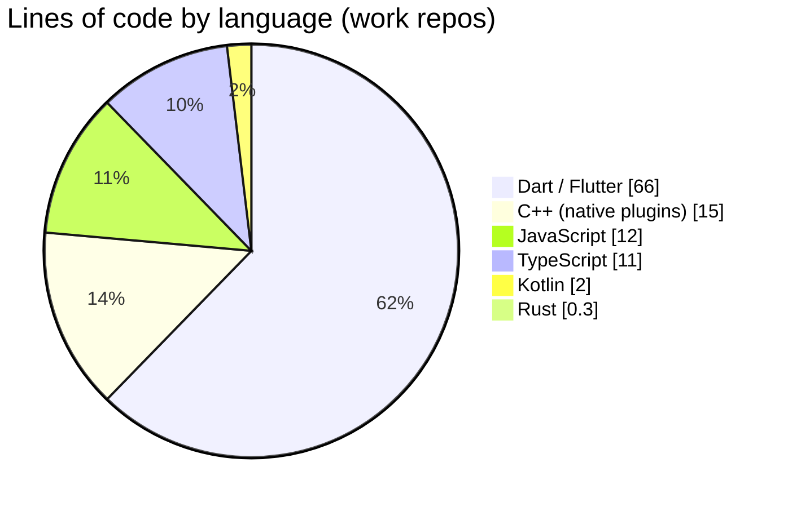
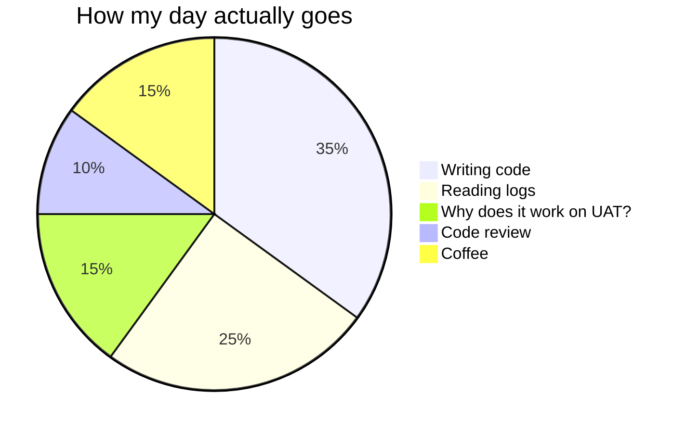

<!-- Header -->


<div align="center">

<a href="https://git.io/typing-svg"></a>

<p>
  <a href="mailto:ankit@mentorpal.ai"></a>
  
  
</p>

</div>

---

### 🧑‍💻 `whoami`

```ts
const ankit = {
  role:        "SDE-2 @ MentorPal",
  ships:       ["Flutter apps", "Node.js APIs", "React admin panels", "Rust services"],
  superpowers: ["real-time video (WebRTC / LiveKit)", "payments & wallets", "debugging prod at 2am"],
  learning:    ["Rust", "DRM / FairPlay", "voice AI & live translation"],
  motto:       "Ship fast, keep it simple, measure in prod.",
  funFact:     "1,000+ commits in my first month on GitHub 🟩",
};
```

### ⚡ What I build

<table>
<tr>
<td width="50%" valign="top">

**📞 Real-time calling**  
1:1 and random video calls, live streaming, network-quality indicators, adaptive call quality.

**💳 Payments & wallets**  
Multiple gateways, subscriptions, refunds, disputes, payouts, and a coin ledger that always adds up.

</td>
<td width="50%" valign="top">

**📱 Mobile at scale**  
A family of Flutter apps (Android + iOS) sharing one in-house calling SDK.

**☁️ Backend & infra**  
Node.js + MongoDB + Redis, Kubernetes cronjobs, analytics and attribution pipelines, moderation services.

</td>
</tr>
</table>

### 🧰 Tech arsenal

<p align="center">
  <br/>
  
</p>

### 📊 Where my code goes



<details>
<summary>🕹️ <b>A typical day (click me)</b></summary>



</details>

### 📈 GitHub stats

<p align="center">
  
  
</p>

<p align="center">
  
</p>

<p align="center">
  
</p>

<p align="center">
  <picture>
    <source media="(prefers-color-scheme: dark)" srcset="https://raw.githubusercontent.com/mpal-ankitsingh/mpal-ankitsingh/output/snake-dark.svg" />
    
  </picture>
</p>

### 😂 Dev joke of the day

<p align="center">
  
</p>

<details>
<summary>🎯 <b>Currently</b></summary>

- 🔭 Working on real-time voice translation inside calls
- 🦀 Writing my first production Rust service
- 🎬 Exploring DRM-protected video streaming
- 🤝 Open to talk about Flutter, WebRTC and payments

</details>


